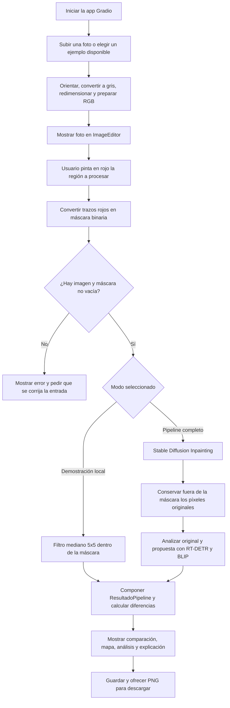

# Flujo de procesamiento del MVP

Este documento describe qué sucede desde que se abre la interfaz hasta que se
descarga un resultado. La implementación está principalmente en
[`app.py`](./app.py), [`restaurador/imagenes.py`](./restaurador/imagenes.py),
[`restaurador/procesamiento.py`](./restaurador/procesamiento.py) y
[`restaurador/modelos.py`](./restaurador/modelos.py). Para información general
del proyecto, ver [`README.md`](./README.md).

## Vista general

## 1. Arranque y construcción de la interfaz

Al ejecutar `python app.py`, se construye el bloque `demo` de Gradio. Si se
ejecuta el archivo directamente, la aplicación inicia una cola de eventos y
escucha localmente en `127.0.0.1`. En Colab, `colab.ipynb` importa `app.demo` y
lo lanza con un enlace compartible.

La interfaz presenta un `ImageEditor`, una vista previa de la máscara, el
selector de modo, parámetros de IA inicialmente ocultos y un panel de resultados
que se muestra al terminar el procesamiento. El modo inicial es la demostración
local.

Al cargar la app, `app.py` comprueba si existen dos ejemplos en
`modelos_difusion/datos/`. Solo agrega al menú los archivos que encuentra. Esa
carpeta no está en la estructura actual del proyecto, por lo que normalmente
se sube una foto manualmente. Las imágenes de `images/` no se conectan
automáticamente al selector.

## 2. Carga y preparación de la fotografía

Al subir una foto, el evento `editor.upload` llama a
`preparar_editor(datos_editor)` en `app.py`. Si Gradio entrega una imagen válida:

1. `preparar_imagen` en `restaurador/imagenes.py` aplica la orientación EXIF.
2. Convierte la imagen a escala de grises.
3. Reduce el lado más largo a un máximo de 512 píxeles. Las dimensiones se
   ajustan a múltiplos de 8 para el modelo de difusión, manteniendo la
   proporción de forma aproximada.
4. Devuelve la imagen en RGB —los tres canales representan la misma intensidad
   al inicio— para que sea compatible con los modelos.
5. La interfaz la establece como fondo del editor y limpia sus trazos previos.

Los errores de lectura o preparación se muestran como errores de Gradio. Los
modelos no se cargan en esta etapa.

## 3. Dibujo y conversión de la máscara

El usuario pinta sobre el editor con el pincel rojo. El evento `editor.change`
llama a `actualizar_vista_mascara`, que obtiene el fondo y el compuesto actual
del editor.

`extraer_mascara_canvas` identifica como trazo los píxeles cuyo canal rojo es
suficientemente alto y supera a los canales verde y azul. Produce una máscara
binaria:

- **Blanco (255):** zona que puede modificarse.
- **Negro (0):** zona que se conserva.

`normalizar_mascara` la convierte a escala de grises, la alinea con el tamaño de
la foto usando vecino más cercano y elimina grises intermedios mediante un
umbral. La vista previa muestra la zona blanca superpuesta en rojo con
transparencia.

La misma extracción se vuelve a realizar al solicitar el procesamiento; la
vista previa no es la máscara que se pasa como una entrada independiente al
pipeline.

## 4. Validaciones antes del procesamiento

Al pulsar el botón, `procesar(...)` en `app.py` vuelve a obtener la imagen y la
máscara desde el editor y verifica que:

1. haya una fotografía válida;
2. la máscara no esté vacía.

Si falta alguno de esos elementos, se muestra un error que indica qué debe
corregirse. Luego se calcula una clave de solicitud con los datos de imagen,
máscara, modo, prompt, semilla, pasos y fuerza. Esta clave se guarda junto al
resultado para detectar cambios posteriores.

## 5. Selección de la rama de procesamiento

### A. Demostración local, sin IA

`ejecutar_pipeline_basico` en `restaurador/procesamiento.py`:

1. Normaliza imagen y máscara.
2. Aplica `ImageFilter.MedianFilter(size=5)` a la imagen.
3. Usa `componer_solo_mascara` para tomar el filtrado solo en la zona blanca.
   Fuera de la máscara deja los píxeles originales.
4. Calcula el mapa de diferencias y el porcentaje de píxeles modificados.
5. Construye un `ResultadoPipeline` con las imágenes y métricas. Las listas de
   detecciones y las descripciones quedan vacías.

Esta ruta no importa ni carga los modelos de IA. El filtro suaviza información
local, pero no genera contenido nuevo ni reconstruye partes ausentes.

### B. Pipeline completo de IA

`ejecutar_pipeline` en `restaurador/procesamiento.py` ejecuta estas etapas:

#### B.1 Inpainting

`reparar_imagen` valida nuevamente que la máscara no esté vacía y solicita el
pipeline a `cargar_inpainting()` en `restaurador/modelos.py`.

El cargador:

- elige CUDA cuando PyTorch la detecta; de lo contrario, usa CPU;
- usa precisión FP16 en CUDA y FP32 en CPU;
- activa el *attention slicing* de Diffusers;
- mantiene el pipeline en caché durante la ejecución.

La inferencia recibe la imagen, la máscara, el prompt, la semilla, la cantidad
de pasos y la fuerza. La semilla inicializa un generador de PyTorch asociado al
dispositivo seleccionado.

Stable Diffusion produce una imagen propuesta. Después,
`componer_solo_mascara` convierte la salida generada a escala de grises, la
ajusta al tamaño de la imagen si fuera necesario y vuelve a combinarla con la
original: solo copia píxeles generados donde la máscara es blanca. Esto
garantiza que el exterior de la máscara sea idéntico a la entrada, aunque el
modelo haya alterado píxeles fuera de la zona indicada.

#### B.2 Diferencias entre original y propuesta

`crear_mapa_diferencias` compara los canales RGB de ambas imágenes, calcula la
diferencia absoluta media por píxel y cuenta los píxeles cuya diferencia supera
10/255. También colorea el mapa para visualizar la intensidad del cambio.

El porcentaje es una medida de cambio visual entre píxeles. No mide la calidad
de la reparación ni determina si el contenido generado es auténtico.

#### B.3 Análisis visual

`analizar_imagen` obtiene, mediante cargadores bajo demanda:

- **RT-DETR:** detecciones de objetos y sus puntajes.
- **BLIP:** una descripción de imagen, con un máximo de 40 tokens nuevos.

Se ejecuta el análisis primero sobre la foto original y luego sobre la propuesta
reconstruida, una imagen por vez. Ambos reciben una imagen RGB. Los modelos
cargados se almacenan en caché mientras el proceso siga activo; por eso esta
secuencia no libera la memoria ocupada por los modelos entre una imagen y otra.

`app.py` muestra solo detecciones con puntaje igual o superior a 0,50. Las
descripciones se presentan en inglés tal como las genera BLIP. Son análisis
generales: no certifican personas, objetos o detalles reconstruidos.

#### B.4 Resultado agrupado

Ambas ramas producen una instancia de `ResultadoPipeline`, que agrupa:

- imagen original y máscara;
- imagen resultante;
- mapa y porcentaje de diferencias;
- detecciones y descripciones de original y resultado.

En la rama básica, las descripciones y detecciones se dejan vacías. La interfaz
lo explica para que no se interprete su ausencia como un fallo del análisis.

## 6. Presentación, estado y descarga

Cuando el pipeline termina, `procesar(...)` en `app.py`:

1. Guarda la imagen resultante como PNG en un directorio temporal con un nombre
   único.
2. Prepara el estado de finalización y una explicación distinta para cada modo.
3. Devuelve a Gradio el resultado, la clave de solicitud, el antes y el después,
   el mapa de diferencias, las descripciones, las detecciones y la ruta para
   descargar.
4. Hace visible el panel de resultados.

La explicación visible en la interfaz identifica el modo, el tamaño y la
proporción de la máscara, la operación aplicada y el porcentaje de cambio
observado. En el modo básico, precisa que se aplicó un filtro mediano de 5 × 5
sin generar contenido. En el modo de IA, informa semilla, pasos y fuerza de
reconstrucción, y describe la generación y los análisis de RT-DETR y BLIP.
Ambos modos aclaran que el exterior de la máscara se conservó exactamente y que
el porcentaje de diferencia no mide calidad; la salida generativa no verifica
los detalles inventados.

## 7. Cambios en la solicitud y resultados obsoletos

Los componentes de entrada tienen eventos `change` asociados a
`invalidar_resultado_desactualizado`. Si todavía no hay un `ResultadoPipeline`,
la función no modifica la interfaz. Si ya hay uno, vuelve a calcular la clave de
solicitud:

- Si coincide con la clave guardada, conserva lo que se está mostrando.
- Si difiere —por un cambio de imagen, máscara, modo o parámetro— invalida el
  estado anterior, muestra un aviso y oculta el panel hasta volver a procesar.

Así se evita presentar como actual un resultado calculado con entradas
anteriores.

## Mapa de llamadas

| Etapa | Función principal | Módulo |
| --- | --- | --- |
| Preparar imagen subida | `preparar_editor` → `preparar_imagen` | `app.py` → `restaurador/imagenes.py` |
| Leer fondo y máscara | `obtener_imagen_y_mascara` → `extraer_mascara_canvas` | `app.py` → `restaurador/imagenes.py` |
| Vista previa | `actualizar_vista_mascara` → `superponer_mascara` | `app.py` → `restaurador/imagenes.py` |
| Seleccionar procesamiento | `procesar` | `app.py` |
| Modo básico | `ejecutar_pipeline_basico` → `reparar_imagen_basica` | `restaurador/procesamiento.py` |
| Modo IA | `ejecutar_pipeline` → `reparar_imagen` | `restaurador/procesamiento.py` |
| Cargar modelos | `cargar_inpainting`, `cargar_detector`, `cargar_descriptor` | `restaurador/modelos.py` |
| Componer fuera de máscara | `componer_solo_mascara` | `restaurador/imagenes.py` |
| Calcular diferencias | `crear_mapa_diferencias` | `restaurador/imagenes.py` |
| Invalidar resultado anterior | `invalidar_resultado_desactualizado` | `app.py` |

## Qué garantiza y qué no garantiza

- **Sí garantiza:** fuera de la máscara, la composición del resultado conserva
  los píxeles de la imagen de entrada.
- **No garantiza:** que el contenido generado dentro de la máscara coincida
  con lo que había originalmente.
- **No verifica:** la autenticidad histórica, la identidad de personas ni la
  exactitud factual de las descripciones y detecciones.
- **No es una evaluación de calidad:** el mapa y el porcentaje solo describen
  cambios de píxeles.
